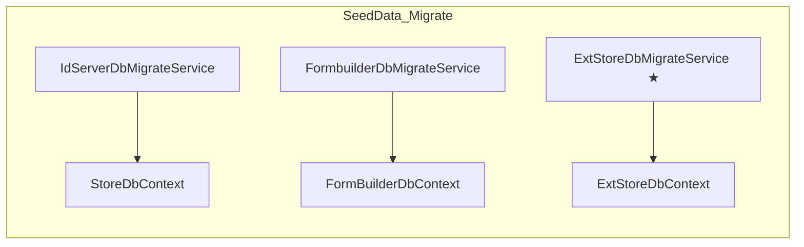

## Context

当前 Migrator 的 `RunMigrationsAsync()` 分三步独立执行：

```
[1/3] SIS migrations      → new StoreDbContext().Database.MigrateAsync()
[2/3] Custom migrations   → new ExtStoreDbContext().Database.MigrateAsync()
[3/3] SeedData()          → await Task.CompletedTask  (空!)
```

只建表，不执行种子数据。而 SimpleIdServer 官方的 `SeedData()` 扩展方法通过 `IDataMigrationService` 统一管理所有 `IDataSeeder`（含 `InitLanguageDataSeeder`）和 `IDbMigrateService`，并自动通过 `DataSeederExecutionHistory` 表跟踪执行历史。

目标：将 Migrator 改为完全遵循 SimpleIdServer 标准的 pipeline。

## Goals / Non-Goals

**Goals:**
- 消除 "default language en is not present" 运行时异常
- Migrator 通过 `SeedData()` 统一执行数据库迁移 + 种子数据
- 官方 13 个 `IDataSeeder` 全部按标准 pipeline 执行
- 自定义 `ExtStoreDbContext` 的迁移也通过 `IDbMigrateService` 纳入 pipeline
- 自定义扩展表的种子数据通过自定义 `IDataSeeder` 纳入 pipeline
- 所有操作幂等，后续运行自动跳过已执行项

**Non-Goals:**
- 不修改 `MinGo.IdServer` 的 `Program.cs`（不移回 `SeedData()`）
- 不修改 `ExtStoreDbContext` 的实体模型
- 不涉及运行时行为变更（仅在 Migrator 阶段变化）

## Decisions

### 决策 1：引入 `SimpleIdServer.IdServer` 包而非引用本地 IdServer 项目

| 方案 | 评估 |
|------|------|
| 引用本地 `MinGo.IdServer.csproj` | Sdk.Web 冲突，传递依赖 Hangfire/MassTransit/Blazor/OpenTelemetry 等大量无关包 |
| 添加 `SimpleIdServer.IdServer` NuGet | 仅传递 `dataseeder`、`Domains`、`Helpers` 等必需依赖 |

**选择**：添加 NuGet 包引用 `SimpleIdServer.IdServer`。

### 决策 2：`IDbMigrateService` 覆盖 SIS + FormBuilder + Ext 三个上下文

`AddEfStore()` 已注册 `IdServerDbMigrateService` (SIS) 和 `FormbuilderDbMigrateService` (FormBuilder)。需新增 `ExtStoreDbMigrateService` 覆盖 `ExtStoreDbContext`。



### 决策 3：自定义种子数据继承 `BaseAfterDeploymentDataSeeder`

SimpleIdServer 的 seeder 分为两类：
- `BaseBeforeDeploymentDataSeeder` - 部署前执行（如 `AddMigrationsScopeDataSeeder`）
- `BaseAfterDeploymentDataSeeder` - 部署后执行（如 `InitLanguageDataSeeder`）

自定义 `InitUserProfileDataSeeder` 也继承 `BaseAfterDeploymentDataSeeder`，确保在迁移完成后执行，自动获得幂等跟踪。

### 决策 4：Seeds 统一注册在同一 `ServiceCollection`

`SeedData()` 需要一次性获取所有 `IEnumerable<IDataSeeder>` 和 `IEnumerable<IDbMigrateService>`。因此所有注册必须在同一个 `ServiceCollection` 中：

```csharp
var services = new ServiceCollection();
services.AddEfStore(...);              // SIS repos + IDbMigrateService x2
services.AddDbContext<ExtStoreDbContext>(...);
services.AddDataseeder();              // IDataMigrationService
RegisterSisDataSeeders(services);      // 14 × IDataSeeder
services.AddTransient<IDbMigrateService, ExtStoreDbMigrateService>();
services.AddTransient<IDataSeeder, InitUserProfileDataSeeder>();
var sp = services.BuildServiceProvider();
sp.SeedData();
```

### 决策 5：移除原三步独立流程

`SeedData().Migrate()` 内部通过 `IDbMigrateService` 执行 `Database.MigrateAsync()`，与当前 Step 1/2 等效。移除原三步流程，避免重复调用混淆。

## Risks / Trade-offs

| 风险 | 缓解措施 |
|------|---------|
| `AddMigrationsScopeDataSeeder` 依赖 admin client 存在，数据库全新时可能提前 return | 无害 — 下次运行该 seeder 时自动跳过 |
| `SeedData()` 内部无控制台日志，迁移过程不透明 | 在 `SeedDataAsync()` 外层包裹 `Console.WriteLine` 日志 |
| `ConfigureDataSeeders` 是 `private static`，需手动逐行注册 14 个 seeder | 版本升级时需同步更新列表。封装为 `RegisterSisDataSeeders()` 方法，集中管理 |
| `ExtStoreDbMigrateService` 不通过 EF Core 原 `DbContextOptionsBuilder` 注册，可能丢失某些 provider 配置 | `AddDbContext` 使用与 Step 2 相同的 `ConfigurationHelper.BuildDbContextOptions`，确保一致 |
